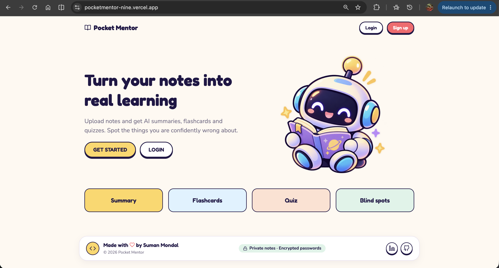
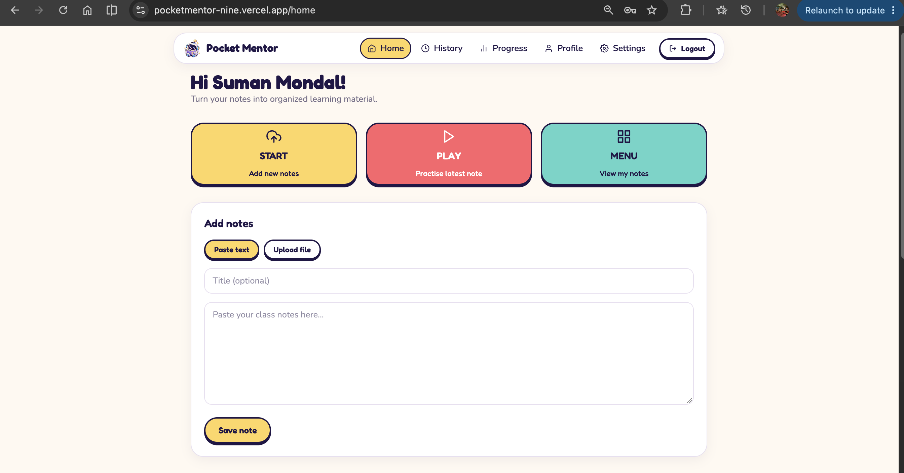
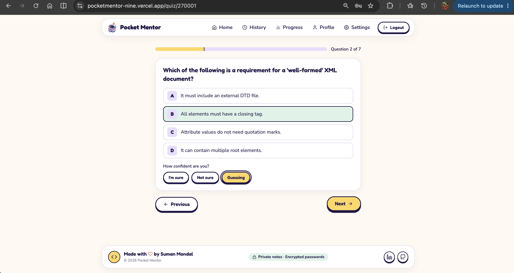
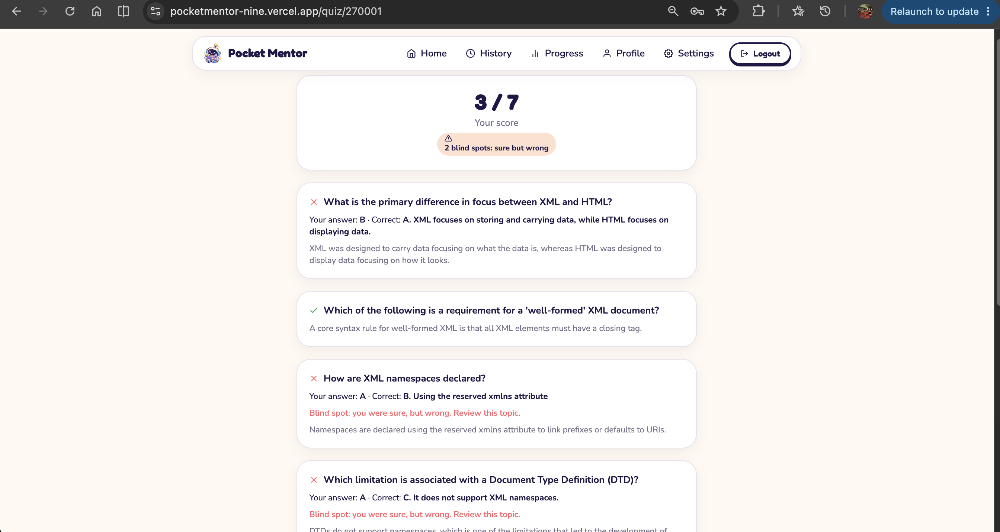
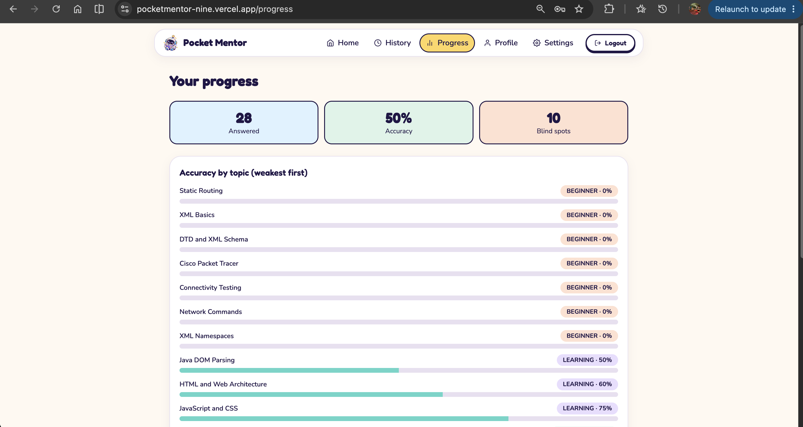
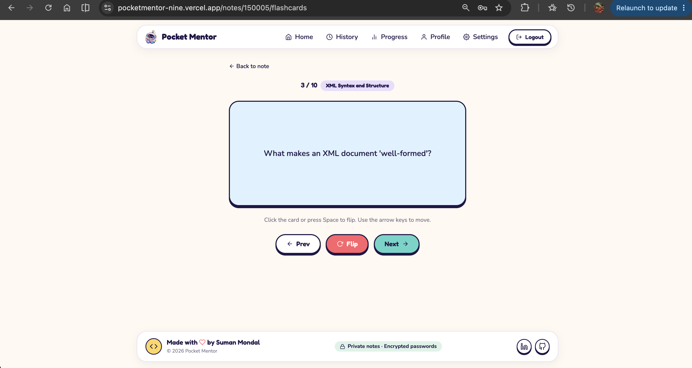

# Pocket Mentor: Frontend

React web app for **Pocket Mentor**, an AI-powered study companion that converts class notes into summaries, flashcards and confidence-rated quizzes.

- **Backend repo:** `https://github.com/sumanmondal02/pocketmentor`
- **Developer:** Suman Mondal

## Screenshots

| Landing | Dashboard | Quiz with confidence |
|---|---|---|
|  |  |  |

| Results and blind spots | Progress | Flashcards |
|---|---|---|
|  |  |  |

## Features
- Landing page, register and login; logged-in users are redirected away from `/login` and `/register`
- Paste text or upload a PDF/TXT file
- Notes list with status (Ready, Processing, Not generated) and flashcard/question counts
- AI generation with a polling progress screen and a jumping-mascot loader
- Flashcards with a 3D flip, previous/next, and keyboard support (arrows and space)
- Quiz with a confidence rating per answer; results show score, explanations and blind spots
- Retake quiz built from weak questions
- Progress dashboard: accuracy by topic, mastery levels, quiz history
- History with search, filters, sorting and date grouping
- Profile (rename) and Settings (change password, reduce animations)
- Responsive layout, accessible focus states, reduced-motion support

## Tech stack
| Area | Technology |
|---|---|
| Framework | React (Vite), JavaScript |
| Styling | Tailwind CSS v4 with custom design tokens |
| Routing | React Router |
| HTTP | Axios with a JWT interceptor |
| Icons | react-icons |
| Hosting | Vercel |

## Project structure
```
src/
  api.js              Axios instance, auth header, error helper
  AuthContext.jsx     Login state and session handling
  components/         Layout, Footer, Loader, StatusBadge
  pages/              Landing, AuthPage, Home, NotePage, Flashcards,
                      Quiz, Progress, History, Profile, Settings
  index.css           Design system (colors, buttons, cards)
public/mascot.png
vercel.json           SPA rewrite so refreshing deep links works
```

## Run locally
**Requirements:** Node.js 18+ and the backend running (see the backend repo).

```bash
npm install
```
Create a `.env` file (git-ignored):
```
VITE_API_URL=http://localhost:8080
```
Start the dev server:
```bash
npm run dev
```
Open `http://localhost:5173`.

## Build
```bash
npm run build
```

## Deployment
Deployed on Vercel. Set the environment variable `VITE_API_URL` to the backend URL (no trailing slash). The backend's `FRONTEND_URL` must exactly match the Vercel URL, otherwise the browser blocks requests (CORS).